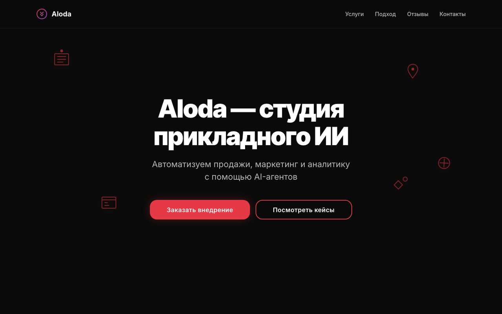
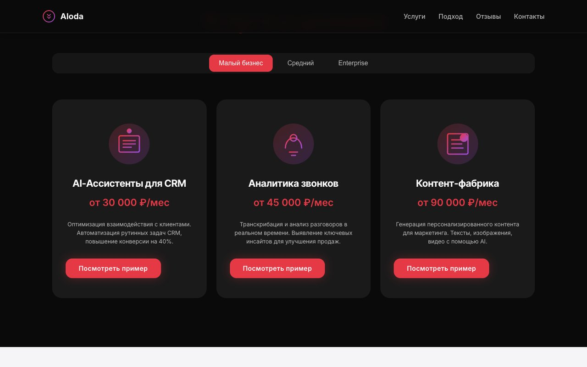
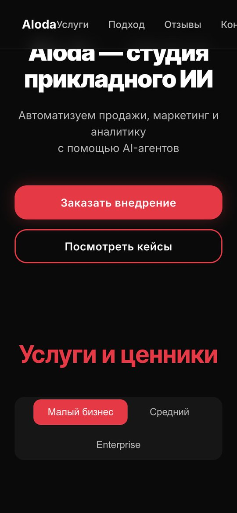

# ALODA — AI integration studio website (static)

The website of ALODA, a studio that builds and integrates custom AI solutions: AI assistants for CRM, call analytics and a content factory. The repository contains the original page exports (home, services, case studies, about) and a cleaned, framework-free **standalone** version with its own design system.



| Services and pricing | Mobile |
|:---:|:---:|
|  |  |

## Services on the page

| Service | Description |
|---|---|
| **AI assistants for CRM** | Automate routine CRM work and client communication |
| **Call analytics** | Transcription and analysis of sales calls, key insights |
| **Content factory** | Personalised marketing content: texts, images, video |

Each service has small / medium / enterprise tabs with pricing.

## Standalone site

```
standalone_site/
├── index.html
├── css/
│   ├── design-tokens.css   — design-system variables and tokens
│   ├── components.css      — reusable UI components
│   └── main.css            — layout and section styles
├── js/
│   ├── animations.js       — hero animation, carousel, tabs, scroll reveals
│   └── main.js             — initialisation
└── images/
```


Highlights: animated neural-network hero, floating icons, tabbed services with pricing, testimonials carousel, scroll animations, responsive layout.

## Run locally

```bash
cd standalone_site
python3 -m http.server 8000
```

## Deployment

```bash
docker compose -f docker-compose.prod.yml up -d --build
```

See [`DESIGN_SYSTEM.md`](DESIGN_SYSTEM.md) and [`IMPLEMENTATION_GUIDE.md`](IMPLEMENTATION_GUIDE.md). A newer Next.js version of the site lives in [finalsite](https://github.com/Fortuneq/finalsite).
